

Data Analytics &amp; Data Science · Project Report · 2026

<h1>Predicting Hotel Booking Cancellations</h1>

Can a hotel tell, at the moment a booking is made, which reservations are likely to be canceled, and what should it do about it?

Chayut P.

## Contents

1. Executive Summary
2. Problem & Objectives
3. Data Understanding
4. Data Preparation
5. Exploratory Data Analysis
6. Method / Modeling
7. Results & Evaluation
8. Interpretation & Insights
9. Recommendation
10. Limitations & Conclusion
- Appendix A: Feature list · Appendix B: Reproducing the analysis · References

## 1. Executive Summary

**Problem.** In two Portuguese hotels, 37% of all bookings were canceled. That is about 154,000 room-nights and €16.7 million of booked revenue over 26 months. Rooms that are canceled late often stay empty. If the hotel knew earlier which bookings were risky, it could plan for them.

**Data.** I used 119,390 real bookings (July 2015 to August 2017) from a City Hotel in Lisbon and a Resort Hotel in the Algarve, published by Antonio, Almeida & Nunes (2019). After cleaning, 119,206 bookings remained.

**Approach.** I cleaned the data and removed five columns that "leak" the outcome because they are only filled in after the booking. I explored which factors go with cancellation, then compared five models: a baseline, Logistic Regression, a Decision Tree, a Random Forest and Gradient Boosting. To make the test closer to real use, I trained on 2015–2016 arrivals and tested on 2017 arrivals, which the model never saw.

**Key findings.**

- Cancellation risk is driven mainly by sales channel and deposit type (group blocks and "Non-Refund" rates booked by agents), country (domestic bookings), lead time (bookings made far ahead), and guest engagement (special requests lower risk).
- The selected model (Random Forest) reaches ROC-AUC 0.84 and PR-AUC 0.80 on 2017 bookings, compared with 0.50 and 0.39 for the baseline. At my chosen threshold it catches 70% of cancellations, and 71% of the bookings it flags really do cancel.
- A simple business rule (Non-Refund, or lead time over 90 days, or a previous cancellation) catches a similar share of cancellations but with only 51% precision. Under my cost assumptions the model creates about €2.06M of net value over 8 months, vs €1.44M for the rule.
- Simpler models are almost as good on future data. Logistic Regression reaches ROC-AUC 0.837, so most of the value comes from the *features* rather than from model complexity.

**Recommendation.** Score every new booking and sort it into three risk tiers. The *High* tier is 16% of bookings, of which 88% cancel. For these: ask for a deposit or confirmation, and make them the basis of a careful overbooking allowance. The *Medium* tier gets reminder and upsell messages. The *Low* tier needs no action. Pilot this at the City Hotel first, where the model is most reliable, and measure the effect with an A/B test before rolling it out.

## 2. Problem & Objectives

### 2.1 Background

An empty hotel room cannot be sold again later, so a night without a guest is lost revenue. Cancellations are normal in the hotel business. Most online bookings can be canceled for free, and travel agents often reserve blocks of rooms they may not sell. But when a cancellation comes late, the hotel has little time to resell the room. Hotels protect themselves with overbooking (selling more rooms than they have) and deposit policies. Both have a cost. If the hotel overbooks too much, some guests have to be moved to another hotel ("walked"). If it asks everyone for a deposit, some good guests will book somewhere else.

### 2.2 Problem statement

> *Using only information available at the moment a booking is made, can I predict whether the booking will be canceled, accurately enough that the hotel can act on the prediction? And which booking characteristics are linked to higher cancellation risk?*

**Who cares:** the hotel's revenue manager (overbooking and pricing), the reservations team (deposits, reminders), and the sales team (contracts with travel agents).

### 2.3 Objectives

1. Understand and clean the booking data, and identify columns that cannot be used because they leak the outcome.
2. Describe which types of bookings cancel most (EDA).
3. Build a classification model and compare it with a baseline and a simple business rule.
4. Explain what drives the predictions and where the model fails.
5. Turn the results into a recommendation the hotel could test.

### 2.4 Success criteria

| Criterion | Target |
|---|---|
| Beats the "always not canceled" baseline | Clearly higher ROC-AUC and PR-AUC |
| Beats a simple rule a manager could use without a model | Higher precision at similar recall, and higher net value |
| Useful at a realistic threshold | Catches ≥ 65% of cancellations with precision ≥ 65% |
| Realistic test | Tested on later bookings (2017), with no leaky columns |
| Explainable | Main drivers can be explained to a non-technical manager |

## 3. Data Understanding

### 3.1 Source

*Hotel Booking Demand* dataset: Antonio, N., de Almeida, A., & Nunes, L. (2019), *Data in Brief* 22, 41–49. The data comes directly from the hotels' property-management systems, and personal guest data has been removed. I downloaded the public copy from TidyTuesday (2020-02-11, `hotels.csv`). It is identical to the Kaggle "Hotel Booking Demand" file.

### 3.2 Observations and variables

- 119,390 rows × 32 columns. One row is one booking.
- Two hotels: City Hotel (79,330 bookings) and Resort Hotel (40,060).
- Period: arrivals from 1 July 2015 to 31 August 2017.
- Variable types: 16 integer, 4 decimal, 12 text/categorical.

The columns describe the booking (lead time, dates, nights, guests, room type, meal, deposit type, price), how it was sold (market segment, distribution channel, agent/company), and the guest (country, repeat guest, previous cancellations). The full list is in Appendix A.

### 3.3 Target variable

`is_canceled` = 1 if the booking was canceled (including no-shows), 0 otherwise. 37.0% of bookings are canceled (44,224 of 119,390). The classes are imbalanced but not extreme. Note that a useless model that always predicts "not canceled" is already 63% accurate, so accuracy is not a good metric here. I use precision, recall, F1, ROC-AUC and PR-AUC instead.

### 3.4 When is each column known? (the leakage check)

A model used at booking time may only use information that exists at booking time. I found five columns that are filled in later:

| Column | Evidence | Decision |
|---|---|---|
| `reservation_status` | "Canceled"/"No-Show" ⇔ `is_canceled` = 1 exactly; it *is* the target | Drop |
| `reservation_status_date` | Date of the final status (cancellation or check-out) | Drop |
| `required_car_parking_spaces` | **0%** of bookings with a parking space canceled, which suggests it is recorded at arrival | Drop |
| `assigned_room_type` | Room changed vs booked: 5% cancel vs 42%, because a canceled guest is never assigned a room | Drop |
| `booking_changes` | Counts changes until check-in or cancellation, so it keeps growing after booking | Drop |

### 3.5 Data quality issues

| Issue | Size | Handling (Section 4) |
|---|---|---|
| `company` missing | 112,593 (94.3%) | Replaced by flag `has_company` |
| `agent` missing | 16,340 (13.7%) | Replaced by flag `has_agent` |
| `country` missing | 488 (0.4%) | Filled with "Unknown" |
| `children` missing | 4 | Filled with 0 |
| Exact duplicate rows | 31,994 (26.8%) | Kept, with sensitivity test (see 4.4) |
| Bookings with 0 guests | 180 | Removed |
| ADR negative (−6.38) / extreme (€5,400) | 2 | Removed |
| `meal` = "Undefined" (same as "SC") | 1,169 | Merged into "SC" |
| `market_segment` = "Undefined" | 2 | Removed |

**Suitability.** The data fits the problem well. It is real, large, labeled, and covers more than two years of seasons. Its main weaknesses are that it covers only two hotels in one country, it has no booking ID (so duplicates are ambiguous), and some fields may have been edited after booking. I return to these in Section 10.

## 4. Data Preparation

All steps are done in code (`notebooks/02_data_preparation.ipynb`). No manual editing was done, so anyone can reproduce the clean file.

### 4.1 Missing values

`agent` and `company` are ID numbers. A missing value means "no agent" or "no company", not "unknown". The ID itself is not a meaningful number, so I replaced both columns with yes/no flags (`has_agent`, `has_company`). `country` gets "Unknown" and `children` gets 0. After this step, no missing values remain.

### 4.2 Impossible values and outliers

| Step | Rows removed |
|---|---|
| `market_segment` = "Undefined" | 2 |
| Bookings with 0 adults, 0 children and 0 babies | 180 |
| Negative ADR, plus one ADR of €5,400 (100× the median) | 2 |
| **Total** | **184 (0.15%)**, leaving **119,206 rows** |

Other large values, such as lead times of 700 days or guests with 26 previous cancellations, are rare but *possible*, so I kept them. Tree models are not affected by extreme values, and for Logistic Regression I standardize numeric features.

### 4.3 Data types

Arrival year, month name and day were combined into a real `arrival_date`. The month name was converted to a number. I also derived a `booking_date` (= arrival date − lead time).

### 4.4 Duplicates

27% of rows are exact copies of another row. Because the dataset has no booking ID, I cannot tell whether a copy is an error or a real separate room in a group booking (same agent, same dates, same price). Group bookings are common in this data. Dropping all copies would remove real demand and change the cancellation rate from 37% to 27%.

**Decision:** keep the duplicates, and protect the evaluation from them in two ways:

1. Test on a time-based split, and group the cross-validation folds by arrival week. Copies of one group booking share dates, so they cannot end up on both sides of a split.
2. Re-run the final model on de-duplicated data as a sensitivity check (Section 7.5).

### 4.5 Feature creation

| New feature | Definition | Why |
|---|---|---|
| `total_nights` | weekend + week nights | Length of stay |
| `total_guests` | adults + children + babies | Party size |
| `is_family` | children or babies > 0 | Families plan differently |
| `arrival_dayofweek` | 0 = Monday … 6 = Sunday | Business vs leisure trips |
| `country_group` | Top 10 countries, all others = "Other" | Avoids 170+ rare categories |
| `is_domestic` | country = PRT | Domestic guests cancel more (EDA) |
| `had_previous_cancel` | previous_cancellations > 0 | Simple history flag |
| `has_agent`, `has_company` | See 4.1 | Booking source |

The cleaned file is saved as `data/hotel_bookings_clean.csv`, with a row-count log in `reports/cleaning_log.csv`.

## 5. Exploratory Data Analysis

Each chart answers one question in the sequence *Question → Evidence → Observation → Interpretation*. Orange bars are above the overall cancellation rate (37%) and blue bars are below it.

### 5.1 How big is the problem, and does it differ by hotel?

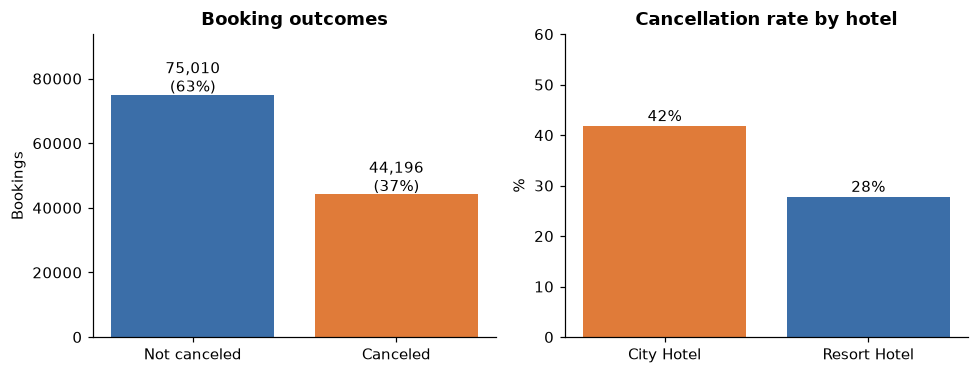

**Observation:** 37% of bookings cancel, 42% at the City Hotel vs 28% at the Resort. Interpretation: the problem is large and the two hotels behave differently, so `hotel` is a model feature and results should be checked per hotel.

### 5.2 Do bookings made far in advance cancel more?

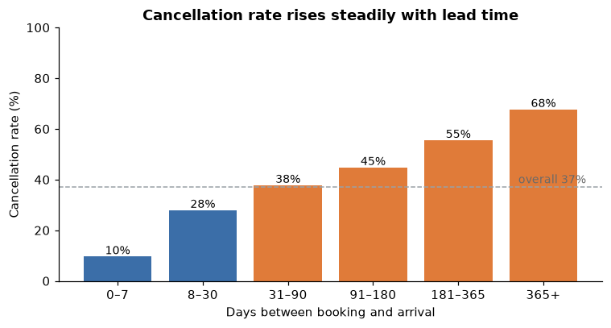

**Observation:** the cancellation rate rises steadily with lead time, from 10% for bookings made in the last week to 68% for bookings made more than a year ahead. Interpretation: the more time there is before arrival, the more time there is for plans to change or for the guest to find a better deal. Lead time is a strong signal and is known at booking.

### 5.3 Does a deposit protect the hotel?

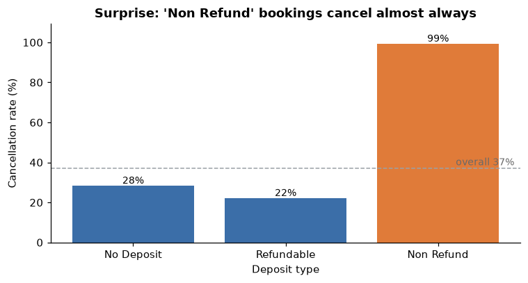

**Observation:** surprisingly, 99% of "Non-Refund" bookings are canceled, compared with 28% for "No Deposit". 97% of Non-Refund bookings come from Portugal, mostly through *Groups* (63%) and *Offline travel agents* (34%).

**Interpretation:** at first I thought this was a data error. It does not mean deposits cause cancellations. A more likely explanation is that travel agents and tour operators *block* rooms for groups under a non-refundable contract and later release the rooms they did not sell. These releases appear as cancellations. The pattern is real and useful for prediction, but it is a correlation with a type of contract, not a causal effect of the deposit. It would be wrong to recommend "remove deposits to reduce cancellations".

### 5.4 Which sales channels are riskiest?

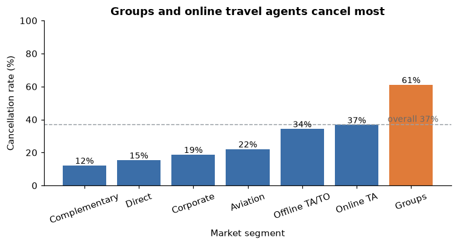

**Observation:** Groups (61%) and online travel agents (37%) are above average. Direct (15%) and Corporate (19%) bookings rarely cancel. Interpretation: online platforms make free cancellation easy ("book now, decide later"), while guests who book directly with the hotel are more committed.

### 5.5 Is there a seasonal pattern?

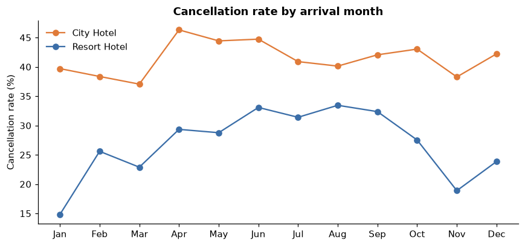

**Observation:** the Resort's cancellation rate roughly doubles from about 15% in January to about 33% in summer. The City Hotel stays high all year (38–46%). Interpretation: for the Resort, cancellations are highest when demand is highest. An empty room hurts most then, but it is also easiest to resell. Arrival month is a model feature.

### 5.6 Are engaged guests more reliable?

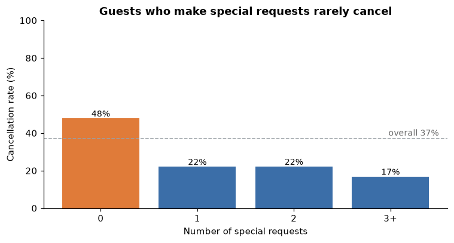

**Observation:** bookings with no special request cancel 48% of the time. With one or more requests the rate drops to about 20%. Interpretation: a guest who asks for a high floor or a baby cot is really planning the trip. Engagement is a sign of commitment.

### 5.7 Does guest history matter?

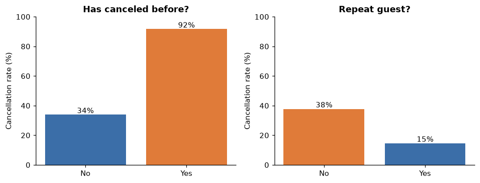

**Observation:** guests who canceled before cancel again 92% of the time. Repeat guests cancel only 15%. Interpretation: past behaviour predicts future behaviour, and loyal guests are low risk.

### 5.8 Do canceled bookings have different prices?

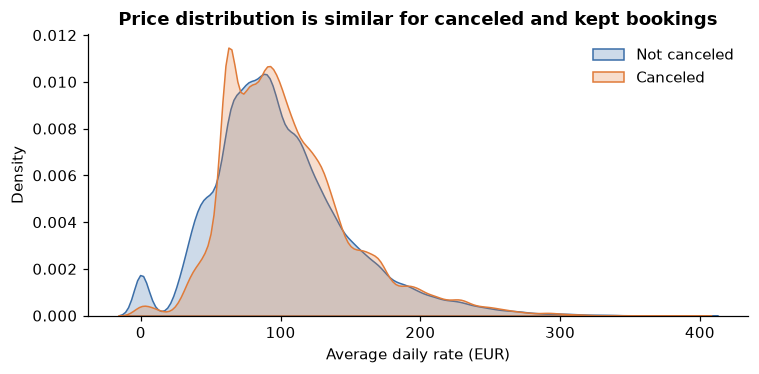

**Observation:** the price distributions of canceled and kept bookings overlap almost completely (median €96 vs €93). Interpretation: price alone tells me little. It may still help in combination with season and hotel.

### 5.9 Domestic vs foreign guests

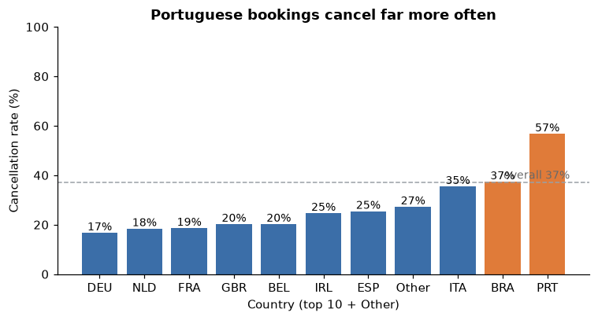

**Observation:** Portuguese bookings cancel 57% of the time. Most foreign markets cancel 17–25%. Interpretation: domestic guests can cancel cheaply because they have no flights to lose, and most group blocks are domestic. Caution: the data authors note that a guest's country may only be confirmed at check-in. For canceled bookings, a default "PRT" may never be corrected, which could exaggerate this pattern. I test the model without country in Section 7.5.

### 5.10 Relationships between numeric features

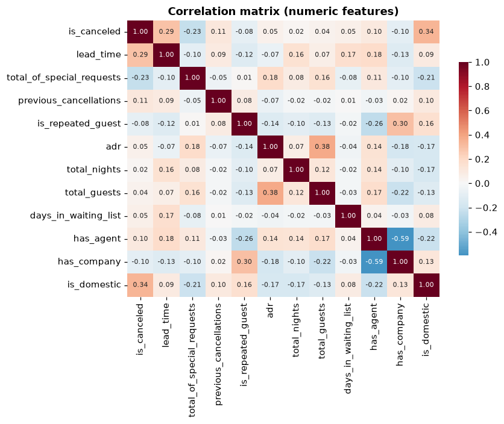

The strongest linear relationships with cancellation are `is_domestic` (+0.34), `lead_time` (+0.29) and `total_of_special_requests` (−0.23). No two features are so strongly correlated that they would cause problems for the models.

### 5.11 EDA summary: hypotheses for the model

1. **Lead time** increases risk.
2. **Channel** matters: Groups and Online TA are high risk, Direct and Corporate are low.
3. **Non-Refund** and **domestic** bookings are high risk, probably because of group blocks (correlation, not causation).
4. **Engagement** (special requests, repeat guest) lowers risk.
5. **Previous cancellations** strongly increase risk.

## 6. Method / Modeling

### 6.1 Problem type

This is binary classification: predict `is_canceled` (1/0). I am interested in the predicted probability as well as the label, because the hotel will choose its own cut-off.

### 6.2 Features

There are 29 features, all known at booking time: 8 categorical (hotel, meal, country group, market segment, distribution channel, reserved room type, deposit type, customer type) and 21 numeric (lead time, arrival month/week/day, day of week, nights, guests, family flag, history, waiting-list days, ADR, special requests, agent/company flags). The five leaky columns from Section 3.4 are excluded.

### 6.3 Models: baseline → simple → advanced

| Model | Why it is included |
|---|---|
| **Baseline:** always predict "not canceled" | The minimum any model must beat |
| **Business rule:** flag if Non-Refund, or lead time > 90 days, or a previous cancellation | What a manager could do *without* data science, built from the EDA |
| **Logistic Regression** | Simple, fast, interpretable: each coefficient shows the direction of an effect |
| **Decision Tree** (max depth 8) | Readable if-then rules and captures interactions |
| **Random Forest** (300 trees) | Many trees vote together, which is more accurate and stable than one tree |
| **Gradient Boosting** (HistGradientBoosting) | Trees built one after another, each fixing the previous errors; often the strongest on tabular data |

### 6.4 Pipeline

Every model is wrapped in one scikit-learn `Pipeline`: impute missing values (median) → one-hot encode categories (rare levels grouped together) → standardize numeric features (Logistic Regression only) → model. Because the preprocessing is learned only on the training folds, information from the test data cannot leak into training.

### 6.5 Validation strategy

- Hold-out test = the future. I train on arrivals from July 2015 to December 2016 (78,587 bookings, 36.2% canceled) and test on arrivals from January to August 2017 (40,619 bookings, 38.7% canceled). This is how the hotel would use the model: learn from the past, predict new bookings.
- Model selection = 5-fold cross-validation inside the training period, grouped by arrival week. All bookings arriving in the same week go into the same fold, so copies of a group booking cannot sit on both sides of a fold. I choose the model with the best cross-validated PR-AUC, the metric that focuses on finding cancellations. The 2017 test set is used only once, at the end.
- Threshold choice is also made on the training data (out-of-fold predictions), never on the test set (Section 7.3).

### 6.6 Metrics

- Recall: of all bookings that actually canceled, what share did I flag?
- Precision: of the bookings I flagged, what share actually canceled?
- F1: the balance of precision and recall.
- ROC-AUC: how well the model *ranks* risky bookings above safe ones (0.5 = random, 1 = perfect).
- PR-AUC: the same idea focused on the canceled class (baseline = cancellation rate about 0.39).

## 7. Results & Evaluation

### 7.1 Cross-validation (training period, grouped by arrival week)

| Model | ROC-AUC | PR-AUC | F1 | Recall | Precision |
|---|---|---|---|---|---|
| Baseline | 0.500 | 0.362 | 0.000 | 0.000 | 0.000 |
| Logistic Regression | 0.882 | 0.843 | 0.705 | 0.615 | 0.826 |
| Decision Tree | 0.906 | 0.861 | 0.760 | 0.732 | 0.791 |
| **Random Forest** | **0.926** | **0.899** | 0.781 | 0.712 | 0.866 |
| Gradient Boosting | 0.926 | 0.897 | 0.783 | 0.734 | 0.840 |

Random Forest and Gradient Boosting are tied (standard deviation across folds about 0.01). Random Forest has a slightly higher PR-AUC and is selected.

### 7.2 Final test on 2017 bookings (threshold 0.5)

| Model | Accuracy | Precision | Recall | F1 | ROC-AUC | PR-AUC |
|---|---|---|---|---|---|---|
| Baseline | 0.613 | 0.000 | 0.000 | 0.000 | 0.500 | 0.387 |
| Business rule | 0.626 | 0.513 | 0.671 | 0.582 | 0.635 | 0.472 |
| Logistic Regression | 0.760 | 0.810 | 0.496 | 0.615 | 0.837 | 0.797 |
| Decision Tree | 0.767 | 0.755 | 0.591 | 0.663 | 0.825 | 0.762 |
| **Random Forest** | 0.766 | 0.793 | 0.537 | 0.640 | **0.843** | **0.800** |
| Gradient Boosting | 0.769 | 0.779 | 0.563 | 0.654 | 0.841 | 0.799 |

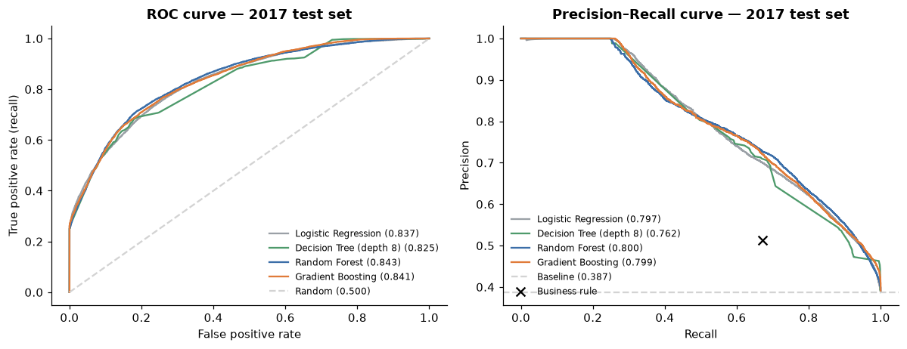

What I see in this table:

- Every model beats the baseline and the business rule by a wide margin in ranking quality (ROC-AUC 0.83–0.84 vs 0.64 for the rule).
- On future data, the four models are very close. Logistic Regression (0.837) is almost as good as Random Forest (0.843). Model complexity adds little. The predictive power comes from good features.
- Scores on 2017 are lower than in cross-validation (0.84 vs 0.93). I expected some drop, but it was bigger than I thought. 2017 has a different booking mix: online travel agents grew from 43% to 56% of bookings, and that is the hardest segment to predict (Section 8.3), while easy-to-predict Non-Refund group blocks fell from 13% to 10%. A model that performs well on past data will lose some accuracy when the market shifts, so it should be retrained regularly.

### 7.3 Choosing the decision threshold

The default cut-off of 0.5 is arbitrary. I set the threshold using a simple, stated cost model:

- Catching a cancellation early lets the hotel resell the room. I assume the hotel recovers 50% of the booking value (ADR × nights).
- Wrongly flagging a guest who would have come (deposit request, or overbooking that forces the hotel to move the guest) costs 20% of the booking value in discounts or goodwill.

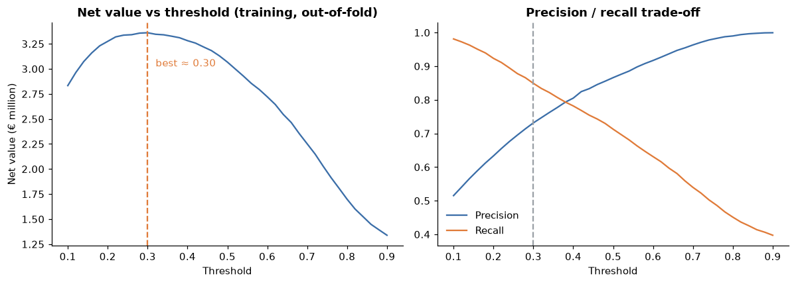

On out-of-fold training predictions, net value peaks at a threshold of 0.30. If my cost assumptions are wrong the threshold moves, but sensibly. When a false alarm costs only 5% of the booking, the best threshold is 0.12 (flag more). When it costs 50%, the best threshold is 0.46 (flag fewer). A hotel can plug in its own costs.

### 7.4 Selected model at threshold 0.30, 2017 test

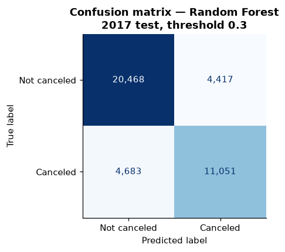

| Metric | Value | Meaning |
|---|---|---|
| Recall | **0.70** | I catch 70% of the bookings that later cancel (11,051 of 15,734) |
| Precision | **0.71** | 71% of flagged bookings really cancel |
| F1 | 0.71 | Up from 0.64 at threshold 0.5 |
| Accuracy | 0.78 | vs 0.61 for the baseline |
| Net value (8 months) | **€2.06M** | vs €1.44M for the business rule (+43%) |

This meets the success criteria in Section 2.4 (recall ≥ 65% *and* precision ≥ 65%).

**Risk tiers.** For staff, three tiers are easier to use than a single cut-off:

| Tier (predicted risk) | Share of bookings | Actual cancel rate | Share of all cancellations |
|---|---|---|---|
| High (> 70%) | 16% | **88%** | 37% |
| Medium (30–70%) | 22% | 59% | 34% |
| Low (< 30%) | 62% | 19% | 30% |

The tiers are well calibrated in order: the actual cancellation rate rises clearly from Low to High. Acting on the High tier alone addresses 37% of all cancellations while touching only 16% of guests.

### 7.5 Robustness checks

| Check (Random Forest, test on 2017) | ROC-AUC | PR-AUC | What it tells me |
|---|---|---|---|
| Main model | 0.843 | 0.800 | Reference |
| *With* the leaky columns (room, parking, changes) | 0.864 | 0.819 | Leakage inflates scores; this version could not work in real life |
| Without country features | 0.822 | 0.781 | Only a small drop, so the model does not depend on the possibly biased country field |
| De-duplicated data | 0.783 | 0.615 | Harder task: most "easy" group-block copies are removed. Still far above baseline |
| Random 70/30 split instead of time split | 0.941 | 0.920 | **Over-optimistic**: copies of the same group leak across the split, and there is no market change over time |

The last row surprised me the most. In my first version I used a normal random split and got a ROC-AUC around 0.94 to 0.96, which looked very good. Only after I switched to the time-based split did I see the real result on future bookings, 0.84. I decided to report the lower number because it is closer to what a hotel would actually get.

## 8. Interpretation & Insights

### 8.1 What does the model rely on?

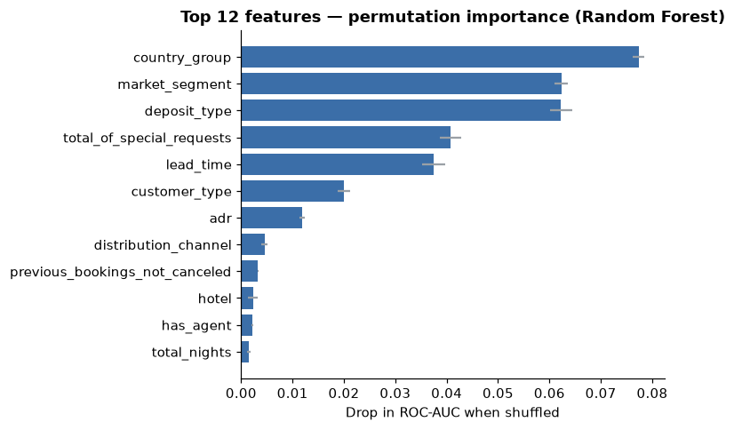

*Permutation importance:* I shuffle one column at a time on the 2017 data and measure how much ROC-AUC drops. The most important features are country group, market segment, deposit type, special requests and lead time, followed by customer type and price. These are the same factors I found in the EDA, so I think the model is picking up real patterns and not noise.

### 8.2 In which direction do features push the risk?

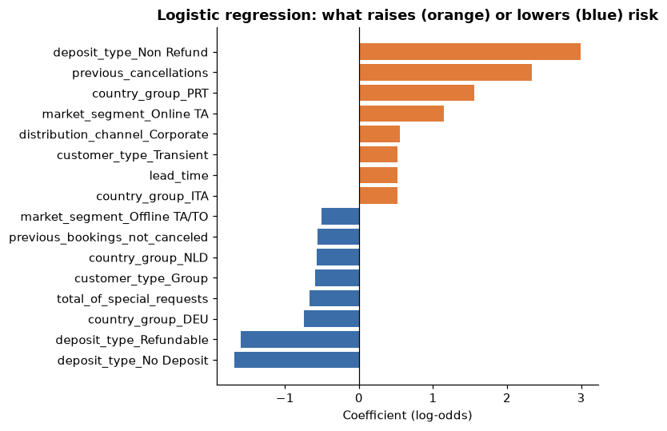

Logistic Regression coefficients show the direction of each effect. Orange bars raise risk: Non-Refund deposit, previous cancellations, Portuguese origin, online travel agent, long lead time. Blue bars lower risk: No-Deposit/Refundable compared with Non-Refund, previous stays that were not canceled, special requests, and German or Dutch guests.

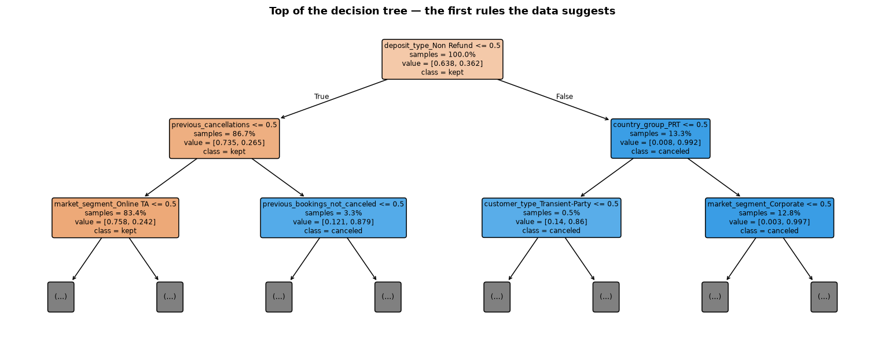

The top of the Decision Tree gives the same story as readable rules. If the deposit is Non-Refund then 99% cancel. Else if the guest has canceled before then 88% cancel. Else online travel-agent bookings are the next split.

### 8.3 Why does it work, and where does it fail? (error analysis at threshold 0.30)

| Segment (2017) | Bookings | Cancel rate | Recall | Precision |
|---|---|---|---|---|
| City Hotel | 27,446 | 43% | 0.77 | 0.72 |
| Resort Hotel | 13,173 | 31% | **0.52** | 0.71 |
| Groups | 5,845 | 58% | 0.98 | 0.92 |
| Offline TA/TO | 5,658 | 34% | 0.95 | 0.86 |
| Online TA | 22,621 | 41% | **0.59** | **0.60** |
| Direct | 4,622 | 16% | **0.27** | 0.50 |
| Lead time 0–7 days | 5,776 | 9% | **0.20** | 0.36 |
| Lead time 180+ days | 8,402 | 52% | 0.75 | 0.81 |

- Works well for group and offline-agent bookings. Their cancellations follow clear contract patterns (Non-Refund blocks, long lead times).
- Struggles with online travel-agent bookings. 82% of the cancellations the model misses are Online TA. These guests look identical at booking time whether they will cancel or not. Their reason to cancel (a cheaper deal found later, a change of plans) is not in the data.
- Struggles with last-minute and Direct bookings, which rarely cancel. When they do, it is hard to foresee.
- Weaker for the Resort (recall 0.52) than the City Hotel (0.77). A single threshold is not ideal for both hotels.

**What this means for the hotel:** the model is most trustworthy for the segments that matter most in volume of lost revenue (groups and agents, long lead times). For Online TA bookings it should be combined with *later* signals that the hotel can collect after booking, such as whether the guest opened the confirmation email or did online check-in.

### 8.4 Prediction is not causation

The model tells me *which* bookings are risky, not *why* guests cancel. Most importantly, "Non-Refund → cancels" is a sign of how group contracts are recorded, not evidence that deposits cause cancellations. Removing deposits would not reduce cancellations. Likewise, asking guests to make special requests would not by itself make them commit. The request is a symptom of commitment, not its cause.

## 9. Recommendation

| | |
|---|---|
| **Finding** | 37% of bookings cancel. The risk can be predicted at booking time with ROC-AUC 0.84 on future bookings, much better than a simple rule. |
| **Interpretation** | Risk is concentrated: the High tier (16% of bookings) contains 37% of all cancellations, and 88% of those bookings cancel. |
| **Implication** | Instead of treating all bookings the same, the hotel can target actions at a small group of high-risk bookings and leave most guests untouched. |
| **Action** | Introduce a booking-risk score with three tiers, and pilot it with an A/B test. |

Proposed actions by tier

| Tier | Action |
|---|---|
| **High (> 70%)** | Ask for a deposit or reconfirmation 14–30 days before arrival. Count these rooms in a careful **overbooking allowance**: if 100 high-risk rooms are booked, about 88 are expected to free up. |
| **Medium (30–70%)** | Automated reminder plus a value message (free breakfast, upgrade offer) to increase commitment. Monitor closely. |
| **Low (< 30%)** | No action, so loyal and reliable guests are not annoyed. |

Additional, segment-level actions

- Group and agent contracts: the very high cancellation of Non-Refund group blocks points to the *contracts*, not the guests. Review release dates and attrition clauses with the main agents, so unsold rooms are released *earlier* when they can still be resold.
- Online travel agents: encourage direct booking (best-rate guarantee, member perks). Direct bookers cancel 15% vs 37%.

How to roll out safely

1. Pilot at the City Hotel, where the model is most reliable (recall 0.77).
2. Run an A/B test: half of the high-risk bookings receive the action, half do not. Measure cancellation rate, room-nights recovered, and guest complaints. This is the only way to know whether the action *causes* fewer empty rooms.
3. **Retrain the model every quarter**. The 2017 drop in accuracy shows that booking behaviour changes.
4. Have the revenue manager set the threshold using the hotel's real costs (Section 7.3 shows how).

## 10. Limitations & Conclusion

### 10.1 Limitations and risks

- Generalisation: only two hotels, both in Portugal, from 2015 to 2017. That is before COVID-19 and before many recent changes in online booking. Results may not transfer to other hotels or to today.
- Data recording: with no booking ID, duplicates are ambiguous. `country` may be corrected only at check-in. Other fields may also have been updated after booking in ways I could not detect.
- Assumed costs: the €2.06M net value depends on my assumptions (50% recovery, 20% false-alarm cost). The ranking of model vs rule holds across a range of assumptions, but the euro amount should be recalculated with real hotel costs.
- Concept drift: accuracy dropped from 0.93 (past) to 0.84 (2017) as the booking mix shifted. Without retraining it will drift further.
- Fairness: the model uses guest country. Using nationality to require deposits could be seen as discriminatory. A hotel should review this. The model without country loses little accuracy (0.822 vs 0.843), so this is a realistic alternative.
- Causation: the model predicts but does not explain *why*. Policy changes must be tested (A/B), not assumed.

### 10.2 Lessons learned

1. **Check when each column is recorded.** Five columns looked very useful at first, but they were filled in after the outcome. I only noticed because parking had a 0% cancel rate, which seemed too perfect.
2. **The way you split the data changes the result.** A random split gave 0.94 AUC and the time-based test gave 0.84.
3. **Simple models were almost as good.** I expected Random Forest or Gradient Boosting to win clearly, but Logistic Regression was very close. The features mattered more than the algorithm.
4. **Strange results are worth a closer look.** "Non-Refund cancels 99%" looked like a mistake, but it turned out to tell me about group contracts.

### 10.3 Conclusion

Hotel cancellations can be predicted at booking time with useful accuracy. On unseen 2017 bookings, the Random Forest model ranks risky bookings well (ROC-AUC 0.84). At a cost-based threshold it catches 70% of cancellations with 71% precision, and it beats both a naive baseline and a simple business rule. The strongest warning signs are group and agent contracts with Non-Refund rates, domestic bookings, long lead times, past cancellations, and a lack of special requests. I recommend a three-tier risk score, piloted at the City Hotel with an A/B test.

### 10.4 Next steps

- Add post-booking signals (email engagement, online check-in, price changes for the same room) to improve Online TA predictions.
- Build separate thresholds or models per hotel.
- Estimate real costs with the hotel and run the A/B pilot.
- Turn the model into a daily dashboard of upcoming high-risk arrivals.

## Appendix A: Feature list

| Feature | Type | Description |
|---|---|---|
| hotel | cat | City Hotel / Resort Hotel |
| lead_time | num | Days from booking to arrival |
| arrival_month, arrival_date_week_number, arrival_date_day_of_month, arrival_dayofweek | num | Arrival date parts |
| stays_in_weekend_nights, stays_in_week_nights, total_nights | num | Length of stay |
| adults, children, babies, total_guests, is_family | num | Party |
| meal | cat | BB, HB, FB, SC |
| country_group | cat | Top 10 countries + Other |
| market_segment, distribution_channel | cat | How the booking was sold |
| is_repeated_guest, previous_cancellations, previous_bookings_not_canceled | num | Guest history |
| reserved_room_type | cat | Room type booked |
| deposit_type | cat | No Deposit / Non Refund / Refundable |
| has_agent, has_company | num | Booked via agent / company |
| days_in_waiting_list | num | Days before confirmation |
| customer_type | cat | Transient / Contract / Group / Transient-Party |
| adr | num | Average daily rate (€) |
| total_of_special_requests | num | Number of special requests |
| *Excluded (leaky):* reservation_status, reservation_status_date, assigned_room_type, booking_changes, required_car_parking_spaces | | |

## Appendix B: Reproducing the analysis

See `README.md`. In short: install the packages in `requirements.txt`, place `hotel_bookings.csv` in `data/`, and run notebooks 01 → 04 in order. Every number and figure in this report is produced by those notebooks (random seed 42). Result tables are saved in `reports/`.

## References

- Antonio, N., de Almeida, A., & Nunes, L. (2019). Hotel booking demand datasets. *Data in Brief*, 22, 41–49. https://doi.org/10.1016/j.dib.2018.11.126
- TidyTuesday (2020-02-11). *Hotels* dataset. https://github.com/rfordatascience/tidytuesday
- Pedregosa, F. et al. (2011). Scikit-learn: Machine Learning in Python. *JMLR*, 12, 2825–2830.
